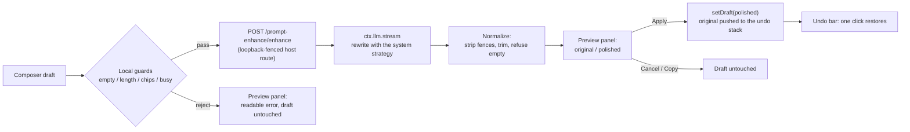

# dsh-prompt-polish

[](https://github.com/rangercd67/dsh-prompt-polish/actions/workflows/ci.yml)
[](./LICENSE)

**Prompt polishing for the [DeepSeek Harness](https://github.com/deepseek-ai) web GUI** — one click (or one shortcut) turns a rough composer draft into a directly usable prompt, and your original draft is always preserved.

> ### Derivative work — read this first
>
> `dsh-prompt-polish` is a **modified, unofficial derivative of [`dsh-prompt-enhance`](https://github.com/rongxingda/dsh-prompt-enhance)** by its author (Apache-2.0). Upstream version **0.2.7** is the base of this project's `1.0.0`.
>
> **What this fork adds:** the plugin is actually *configurable* on the dsh `0.2.x` runtime (upstream's configuration wiring had been removed from the harness, so its settings were silently unreachable), it ships its own configuration page, it no longer leaks its HTTP route when the entry is remounted, it drops pre-0.2 support, and the built-in rewrite strategy is the concise one. The full list is in [Differences from upstream](#differences-from-upstream) and [CHANGELOG.md](./CHANGELOG.md).
>
> **Not endorsed.** This is not an official release of the upstream project, and it is not affiliated with or endorsed by the upstream author or by DeepSeek. See [NOTICE](./NOTICE) for the attribution and the list of changed files.
>
> **Two disclosures before you install.** (1) The plugin serves an **unauthenticated** loopback HTTP route: any local process can call it and spend your model quota. (2) The draft you polish — and, with `contextAware` on, up to `contextMaxMessages` recent turns — is sent to your configured model provider. Both are detailed under [Security & privacy](#security-privacy).

English | [简体中文](./README.zh-CN.md)

---

## What it is

A plugin for the [DeepSeek Harness](https://github.com/deepseek-ai) web GUI. It adds a **polish** affordance to the composer: your draft goes through a low-temperature rewrite pass served by the harness' own LLM service, the result appears in a preview panel next to the original, and you choose to apply it, copy it, or throw it away. Applying raises an undo bar that restores exactly what you had typed.

One npm package, two halves, following the dsh plugin conventions: a **host half** (Node) that owns the HTTP route, the `/enhance` slash command and the settings namespace, and a **browser half** that contributes the composer button, the preview panel, the undo bar and the configuration page.

## Why this fork exists

Upstream `0.2.x` of the harness changed three things that this plugin depended on, and the result was a plugin that installed cleanly and then did nothing you could configure:

1. **Configuration silently disappeared.** dsh `0.2.x` derives a plugin's settings namespace from the `Config` schema the package exports and keeps only fields whose meta is `volatile`. Upstream marked none, so its entry was skipped entirely — no config page, no form, no way to write a value — while the `installSection` / `installSettingsSection` wiring it used instead had already been removed from the harness, so its compatibility probe returned without doing anything or logging anything. This fork marks every field volatile and serves the namespace the way `0.2.x` expects.
2. **The plugin could not be remounted.** Upstream dropped the disposer that `webserver.register()` returns, so the `/prompt-enhance` prefix route outlived the entry that owned it; the next mount died on `webserver: duplicate prefix route "/prompt-enhance"` and left the entry `failed` until the host was restarted. This fork holds the disposer in an effect.
3. **Nothing could be edited where users look.** Because upstream relied on a settings section that no longer existed, the only way to change a knob was to edit the profile's patch file by hand. This fork registers its own `plugins.row.config` page, so the row's configure control on the **Plugins** page opens a real form.

On top of that the built-in strategy is now the concise one (no mandatory acceptance-criteria or boundary-condition sections, no `(待补充：…)` placeholders) and `maxOutputTokens` defaults to 6000 instead of 2048, which is what produced "the rewrite hit the output limit" on long Chinese drafts.

## Features

| | |
|---|---|
| ✨ **Composer button** | A small button in the input box's tool row, next to the send button |
| 🔀 **Preview panel** | Original and polished text side by side, with model name and elapsed time |
| ↩️ **One-click undo** | After applying, a quiet bar above the composer restores the original draft |
| ⌨️ **Shortcut** | Default `Ctrl+Alt+E`, configurable, acts on the composer you are working in |
| 💬 **`/enhance` command** | Rewrite any text from the slash-command plane; the result never enters model history |
| 🧠 **Model routing** | Settings pair → current session model → harness default model, in that order |
| 🔑 **Zero credential setup** | Calls ride the harness LLM service; keys stay in the harness credential store |
| ⚙️ **Live settings** | All sixteen fields, on a page this package ships, applying to the very next call |
| 🛡️ **Draft safety** | Empty, over-length, images-only and reference-chip inputs are refused locally; upstream failures become readable messages; a failed call never touches your draft |


## Install into a dsh profile

This project is prepared for its own npm release but has not been published yet, and the package is **not** on the registry under this name today. Until it is, install it from a checkout (or from this repository's GitHub URL) using the dsh plugin CLI:

```bash
# from a local checkout (built output is committed, so no build step is needed)
git clone https://github.com/rangercd67/dsh-prompt-polish.git
dsh plugin --profile web add link:/path/to/dsh-prompt-polish
# restart dsh web
```

```bash
# from the GitHub URL
dsh plugin --profile web add github:rangercd67/dsh-prompt-polish
```

Once `dsh-prompt-polish` is published under this name, the same command with the bare package name is the shortest path:

```bash
dsh plugin --profile web add dsh-prompt-polish
# restart dsh web
```

The row this package patches has the **id `prompt-enhance`** and the name `dsh-prompt-polish`. The id is deliberate and permanent: it is the settings namespace key, and every existing profile patch targets it. Only the `name:` in [`cordis.patch.yml`](./cordis.patch.yml) follows the package name.

Uninstall:

```bash
dsh plugin --profile web remove dsh-prompt-polish
# check the profile's package.json `dsh.profile.bundles` array for a leftover
# row and remove it if present, then restart dsh web
```

If you use the dsh **desktop application** and install through the profile manager rather than the CLI, see [the 1.0.0 release notes](./docs/history/release-1.0.0.md) for the exact `install_bundle` / rollback steps used to verify this build.

## Configuration

All sixteen fields live in the `prompt-enhance` settings namespace. Edit them on the **Plugins** page: find this plugin's row and use its configure control (the row key is `dsh-prompt-polish#prompt-enhance`, registered by this package — no companion plugin is needed). On a profile that also bundles the harness' own settings surface, the same namespace appears under **Settings → 插件配置**. Changes apply to the very next call; no restart.

Every polish is one billable LLM call. `maxOutputTokens` bounds the cost of one call, and `maxConcurrent` / `rateLimitPerMinute` bound how often calls can be made.

| Field | Default | Description |
|---|---|---|
| `enabled` | `true` | Master switch; off hides the composer button and disables every trigger |
| `provider` | *(empty)* | Explicit route override; must be filled **together with** `model` (or leave both empty to follow the current session model) |
| `model` | *(empty)* | Explicit route override; must be filled **together with** `provider` |
| `temperature` | `0.3` | Sampling temperature (0–1). Low keeps the rewrite faithful to the original |
| `strategyMode` | `replace-default` | How a custom `systemPrompt` combines with the built-in strategy: `replace-default` **swaps it out entirely** (the built-in hard rules — preserve intent, never fabricate, body-only output, language mirroring — are not retained and must be carried into your own text); `extend-default` **appends your text after the built-in strategy**, keeping those rules in force |
| `systemPrompt` | *(empty → built-in strategy)* | Custom strategy text; blank uses the built-in concise strategy |
| `shortcut` | `ctrl+alt+e` | Global shortcut spec (at least one of ctrl/alt/meta plus one alphanumeric or function key; bare keys are ignored so normal typing can never be swallowed); empty disables it |
| `maxOutputTokens` | `6000` | Output token budget of one polish call (256–32768); it bounds that call's cost |
| `maxInputChars` | `12000` | Input character cap (200–200000), counted in Unicode code points — an emoji is one character. Over-length drafts are **rejected, never truncated** |
| `timeoutMs` | `60000` | End-to-end deadline of one call (5000–600000 ms) |
| `maxConcurrent` | `2` | Concurrency cap **within a single host process** (1–16); extra requests answer `429` (`concurrency-limit`). The browser UI admits exactly one in-flight request (a single preview panel), so this cap mainly protects the `/enhance` command plane and multi-client callers |
| `rateLimitPerMinute` | `10` | Sliding-window rate cap per minute **within a single host process** (1–600), counting **successful calls only** — failures never consume the window, so a run of failures cannot rate-limit you out; extra requests answer `429` (`rate-limit`) with a `Retry-After` in seconds |
| `streaming` | `true` | Show the model's output in the panel as it streams instead of waiting for the whole rewrite — **display-only**: the applied text is still the normalized full result, and the client falls back to the one-shot JSON route when the host or network does not support `text/event-stream` |
| `contextAware` | `true` | Ground the rewrite in the current conversation's recent history (resolve pronouns, fill in stated constraints, mirror the established stack and terminology). With no session, no history, or this switch off, the call degrades to the plain single-prompt polish. **Privacy:** the assembled snippet is sent to the configured provider alongside the draft — see [Security & privacy](#security-privacy) |
| `contextMaxMessages` | `8` | Context breadth: how many recent `user`/`assistant` turns may ground the rewrite (0–50); `0` admits none |
| `contextMaxChars` | `4000` | Context depth: character budget of the assembled history snippet (0–100000), spent newest-first so the most recent turns win when the budget is tight; `0` admits none |

**`provider` / `model` values** match the harness settings: each key under the harness' provider settings (for example `zhipu`, `muyuu`) is a provider and each `models[].id` under it (for example `glm-5.3-flash`) is a model. example pair: `provider: zhipu` + `model: glm-5.3-flash`.

**Model routing precedence:** the explicit settings pair → the route recorded in the current session's request header → the harness-wide default model. If none of the three names a route (a fresh session with no default model, say), the plugin fails with an actionable message instead of guessing.

## How it works



**Host half** (`exports "."`, Node) — registers the `/prompt-enhance` prefix route on the shared webserver (`POST /prompt-enhance/enhance` for one JSON envelope, `POST /prompt-enhance/enhance-stream` for incremental SSE frames), the `/enhance` slash command, and the `prompt-enhance` settings namespace derived from the `Config` schema this package exports. The model call goes through `ctx.llm.stream` with a normalized output pass and the same auxiliary-call discipline the harness applies to session titles: deadline and caller cancellation rechecked during and after the stream, terminal-finish validation, tool-call rejection. Settings are read per request from the live composition config, which is what makes a saved change land on the next call without a remount.

**Browser half** (`exports "./client"`) — registers the polish button into the `conversation.input.right` slot and the undo bar into `conversation.input.dock`, keeps a live mirror of the settings namespace, installs the global shortcut, and registers the `plugins.row.config` page keyed `dsh-prompt-polish#prompt-enhance`. All copy is localized (zh/en) through the harness locale system. The half hard-requires no service: `slots`, `locale` and `configForms` are all reached through optional `ctx.inject`, so a profile that lacks one degrades (bundled defaults, dictionary keys) instead of blocking the web boot.

**Configuration page** — the form is the harness' shared `SettingsForm` / `SettingsFormModel` machinery over the `prompt-enhance` namespace, which is what gives it the override badges, per-field reset, revision-fenced save and read-only/unavailable states. It lives in this bundle, so nothing else has to be installed to edit the plugin.

### Using it

**Composer button / shortcut** — type (or leave) a draft and hit ✨ or `Ctrl+Alt+E`:

1. Local guards run first: empty drafts, over-length drafts (never auto-truncated — that would change your meaning), images-only drafts, and drafts containing command or file-reference chips are refused with a clear message. Chips are refused because filling back would destroy them.
2. The preview panel opens with a cancellable spinner. Your draft stays untouched, and the panel says so.
3. The result phase shows both texts side by side. **Apply** fills the polished text back and raises the undo bar; **Copy** puts it on the clipboard; **Cancel** (or `Esc`, or clicking the overlay) discards everything.
4. The undo bar sits above the composer: one click restores the original. If you keep typing after applying, the bar quietly retires itself, so stale text can never overwrite newer edits. Undo entries live **only in the current page's memory** (up to 3 per session) — a reload, a web restart or a session switch clears them.

**`/enhance <text>`** — rewrite any text from the slash menu. The result renders in the command plane (copyable) and never enters the conversation history or the model's context. To polish the *composer draft itself*, use the button or the shortcut: the draft lives in the browser. Cancelling a running `/enhance` follows the harness command plane; if the client offers no cancel affordance, the call runs to completion or times out.

**Language consistency** — the strategy instructs the model to mirror the input language (Chinese in → Chinese out). That is a best-effort instruction, not a guarantee.

### The built-in strategy

The default system prompt makes the model a prompt editor: state the goal and the deliverable, add the steps the task actually needs, and put the constraints the draft itself implies under a short lead-in. It keeps the structure only as heavy as the task requires — no mandatory acceptance-criteria, boundary-condition, role or output-format sections, and **no `(待补充：…)` placeholders**: an unknown detail is simply left out, and only a detail that makes the task impossible to execute becomes one closing question. Length target is roughly 1x–2x the original, and an already-clear draft is polished lightly rather than inflated.

Hard rules: preserve intent exactly; never invent facts, data, names, numbers or constraints; keep the scope unchanged; output **only** the rewritten body (no explanation, no fences, no pleasantries); mirror the input language; treat the framed draft as literal data.

Set `systemPrompt` to use your own strategy; `strategyMode` decides how it combines. The default `replace-default` is a **complete replacement** — the built-in hard rules are not retained automatically, so your own text must include them. `extend-default` appends your text after the built-in strategy instead, keeping those rules in force.

### Errors and edge cases

| Case | Behavior |
|---|---|
| Empty / whitespace / invisible-only draft | Local refusal: "the input box is empty" |
| Draft over `maxInputChars` | Refused locally and at the route with exact counts; **no auto-truncation** |
| Images attached but no text | Refused: text-only feature |
| Command or file-reference chips in the draft | Refused: filling back would destroy the chips |
| Submitting / busy phase, or a request already in flight | Refused with "try again in a moment" |
| Per-minute cap exceeded | `429` (`rate-limit`) with a `Retry-After` in seconds; the host message names the exact wait. The window counts successful calls only |
| Concurrency cap full | `429` (`concurrency-limit`), no `Retry-After` — a slot frees whenever an in-flight call settles |
| Upstream model failure | Stable codes mapped to readable hints: `AUTH` → check the API key, `RATE_LIMIT` → retry later, `QUOTA_EXCEEDED` → check the balance, `CONTEXT_WINDOW_EXCEEDED` → shorten the input, `NO_ADAPTER`/unconfigured → configure a model |
| Output reaches `maxOutputTokens` | Refused with a hint to raise the cap or shorten the draft |
| Model returns empty / fence-wrapped / tool-call output | Normalized (fences stripped) or refused; retryable |
| Timeout | A `504`-mapped message carrying the configured seconds; retryable |
| Browser tab closed mid-flight | The host route notices the disconnect and aborts the model call |
| Session switch | Panel state, undo stack and shortcut targeting are per-session; switching closes the panel and clears its undo entries |

Every failure surfaces inside the plugin's own panel, and the composer draft is never modified by a failed call, so manual input continues undisturbed.

The host route answers structured errors of the shape `{ code, message?, params? }`: the browser renders its localized primary line from `code` + `params` using the current language dictionary, and `message` — when present — is an optional diagnostic detail (the provider's raw failure text, a config error) shown verbatim beneath it. The `/enhance` command plane has no locale dictionary; a host-side renderer of the same errors produces Chinese text directly.

| Error code | HTTP status | Browser primary copy (dictionary key) | Params |
|---|---|---|---|
| `rejected` | 403 / 413 / 415 / 422 | generic `error.rejected`; with `{ count, max }` it reuses `error.tooLong` | over-length input: `{ count, max }` |
| `rate-limit` | 429 | `error.rateLimit` | `{ limit, retryAfterSeconds }` |
| `concurrency-limit` | 429 | `error.concurrencyLimit` | `{ max }` |
| `timeout` | 504 | `error.timeout` | `{ seconds }` |
| `unconfigured` | 409 | `error.unconfigured` | — |
| `upstream` | 502 | generic `error.upstream`; with `reason` it uses `error.upstream.{reason}` (`auth` / `invalidCredential` / `rateLimit` / `quota` / `empty` / `contextWindow` / `toolCall` / `maxTokens`) | `{ reason }` |
| `internal` | 500 / 502 | `error.internal` | — |

### Troubleshooting

**Button missing / shortcut dead** — open the plugin's configure page (Plugins page row) and check `enabled`; check that the plugin is installed (`dsh plugin --profile web list`) and that `dsh web` was restarted; check the browser console for a failed apply.

**"No model resolved for the polish"** — routing follows the settings pair → the session model → the harness default; if all three are empty there is nothing to call. Pair `provider`/`model` in the settings, or send a message in the current session first so it carries a model route, and check the harness' default-model settings section.

**Authentication failures** — the `message` detail line carries the concrete cause (a 401, say). Check the provider's API key in the harness credential store; quota and balance problems surface as the `quota` hint.

**Rate-limited (429) right after a run of failures** — that should not happen, because the window counts successes only. If it does, check whether several profiles or processes are mounted (each counts independently and they stack up) or whether `rateLimitPerMinute` is set too low.

**Poor rewrites (fabrication, dropped requirements, broken formatting)** — with `strategyMode` set to `replace-default`, a custom `systemPrompt` replaces the built-in strategy entirely, hard rules included; carry them into your own text or switch to `extend-default`.

**Project name changed, settings look reset** — the namespace and row id are still `prompt-enhance`, so stored values and existing profile patches keep working across the `dsh-prompt-enhance` → `dsh-prompt-polish` rename. What changes is the package name, and with it the row key of the configuration page (`<package name>#prompt-enhance`); it is injected at build time, so a stale hand-built bundle from an older name will not show the page until it is rebuilt.

## Security & privacy

**1. The loopback HTTP route is unauthenticated by design.** Any process on your machine can `POST /prompt-enhance/enhance` and spend your model quota. Per-caller authentication is not attempted. What guards the route instead:

- **Socket fence** — requests from non-loopback peer addresses are refused (`127.0.0.1` / `::1` only).
- **Host allowlist** — the `Host` header must be `localhost` / `127.0.0.1` / `[::1]`, which defeats DNS rebinding (a rebound attacker domain keeps the loopback socket address but carries the attacker's hostname and is refused). Responses are `cache-control: no-store`.
- **Origin gate** — browser calls from non-local pages are refused.
- **Proxy rejection** — requests carrying `X-Forwarded-For` or `Forwarded` are refused outright: those headers only exist when a proxy is in the path, which the trust model does not cover.
- **Abuse caps** — a body cap derived from `maxInputChars` (with a `Content-Length` fast reject), a sliding-window rate limit (`rateLimitPerMinute`, default 10, counting successful calls only) and a concurrency cap (`maxConcurrent`, default 2), both answering `429`. Both counters live **in a single host process's memory**: several processes, a cluster or several profiles mounting the plugin each count independently, so this plugin supports single-process deployments and ships no shared rate-limit store.
- **Request-level timeouts belong to the host and Node** — the plugin bounds the body size and the per-call `timeoutMs`; connection-level timeouts (headers / request / keep-alive) are settings of the shared `http.Server` that a prefix route must not touch, so they fall to the host and Node's defaults.
- **Not for reverse-proxy exposure** — if you put dsh web behind a proxy that listens on the LAN, external callers look like loopback to the route and the fence is moot. Do not expose a proxied host without adding your own authentication at the proxy.
- **Prompt-injection boundary** — the draft is framed between `<raw_prompt>` tags, literal closing tags inside the draft are neutralized, and the strategy prompt treats the framed text as pure data. That lowers the risk of a simple tag escape; prompt-based boundaries are best-effort, not a guarantee.

**2. Your draft leaves the machine — to the provider you configured.** Browser → your own dsh host (loopback only) → the harness LLM service → the configured model provider. With `contextAware` on (the default), the plugin also assembles the recent `user`/`assistant` history of the current session — up to `contextMaxMessages` turns and `contextMaxChars` characters — and sends it to the same provider alongside the draft. That history may contain secrets you typed earlier in the session (API keys, tokens, internal hostnames, customer names) which the provider will see verbatim. Treat `contextAware` as the privacy boundary: turn it off, or end the session and start a fresh one, when the conversation should not leave the machine. The strategy's rules forbid introducing anything the raw prompt does not support, but they cannot un-share what has already been sent.

**Credentials stay in the harness.** The plugin stores none; the model call rides `ctx.llm` and the API keys are the harness's own. The enhancement never enters the session's model history, and nothing is sent anywhere except the provider the harness routes the call to.

## Compatibility

- **Harness:** `dsh.engines.dsh` = `>=0.2.0-rc.2 <0.3.0`. This fork drops pre-0.2 support: the settings wiring it replaced no longer exists in those lines. `dsh.engines` is advisory metadata read by the loader and plugin manager — it states support, it does not enforce it.
- **Node:** `^22.19.0 || >=24.0.0` (for building from source).
- **Peers:** `@deepseek-ai/dsh-llm >=0.2.0-rc.2` as an **optional** peer — it is a runtime module supplied by the dsh host and is not installed from npm (both `lib/` bundles keep every package import external), so a host that does not provide it produces no install warning and the plugin reports a normal error at polish time instead of failing to load. `react` / `react-dom` `^18.2.0` are required and supplied by the web shell's module registry.
- **Other plugins on a `0.2.x` runtime:** the runtime's compatibility gate skips bundles whose peer ranges pin an older `@deepseek-ai/dsh-*` line (observed upstream with `dshmarket`, `dsh-find-plugin` and `dsh-better-sidebar`). This package passes that gate.

| | |
|---|---|
| dsh | `>= 0.2.0-rc.2 < 0.3.0` |
| Node | `^22.19.0 \|\| >=24.0.0` |
| Plugin | `1.x` |

## Development

```bash
npm install
npm run typecheck     # tsc, no emit
npm test              # unit + real-http + component suites
npm run build         # typecheck + both halves
npm run watch         # esbuild watch for both halves
npm run rename -- --check   # do the package name and the patch row name agree?
```

Daily debug loop (link install + watch): see [CONTRIBUTING.md](./CONTRIBUTING.md).

**`lib/` is built output, and it is committed.** `lib/index.js` is the host half (ESM, package imports kept external); `lib/client.js` is the browser half (CJS inside the `window.__ModuleLoader__.load({ id, factory })` envelope the dsh web shell expects). Both are committed so a GitHub install needs no build step, and CI fails if `lib/` drifts from `src/` — always run `npm run build` before pushing. The **client bundle carries the package name injected at build time** (`scripts/build.mjs`'s `define`, mirrored by `vitest.config.ts`), because the Plugins page dispatches a row's configure control by `<package name>#<row id>`: a rename that is not followed by a rebuild silently detaches the configuration page. `npm run rename -- --name <pkg> [--repo <url>]` performs the rename and `--check` reports whether `package.json` and `cordis.patch.yml` agree. The row **id** stays `prompt-enhance` and must never change.

**Test coverage** (21 files, 216 tests): input validation, output normalization, the enhancer against stubbed `ctx.llm` streams, a real-`node:http` route suite (loopback/Host fence, disconnect abort, error envelopes, SSE end to end), the loopback fence units, prompt framing, config resolution, the undo stack, shortcut parsing, client settings, the configuration page, and React component tests locking the polish → apply → undo flow.

More: [architecture](./docs/dev/architecture.md) · [usage and configuration in depth](./docs/guide/usage-and-configuration.md) · [the `0.2.x` compatibility findings](./docs/compat/dsh-0.2-findings.md) · [docs index](./docs/README.md).

## Publishing

The publishing checklist — name and metadata, the load-bearing `ROW_KEY` coupling, licence and attribution duties, the tarball review, and the post-publish verification steps — is [docs/publish/checklist.md](./docs/publish/checklist.md). Nothing in this repository publishes automatically, and CI has no publish step.

## License & attribution

[Apache-2.0](./LICENSE). `dsh-prompt-polish` is a derivative of [`dsh-prompt-enhance`](https://github.com/rongxingda/dsh-prompt-enhance) (Apache-2.0), based on upstream version 0.2.7; the upstream licence text is retained verbatim and the attribution, changed-files statement and no-endorsement wording are in [NOTICE](./NOTICE). The fork's own release history starts at `1.0.0` and is independent of upstream's numbering — see [CHANGELOG.md](./CHANGELOG.md).

## Differences from upstream

Against upstream `dsh-prompt-enhance` 0.2.7 (the base of this project's 1.0.0). The full rationale is in the [1.0.0 release notes](./docs/history/release-1.0.0.md) and the [compatibility findings](./docs/compat/dsh-0.2-findings.md).

| Area | Upstream 0.2.7 | This project 1.0.0 |
|---|---|---|
| Settings namespace on `0.2.x` | No `Config` field marked volatile, so the harness skips the entry and it is not configurable anywhere | Every `Config` field marked volatile (through the public schemastery's `meta`), so `0.2.x` serves the `prompt-enhance` namespace |
| Configuration page | None; relied on `installSection` / `installSettingsSection`, both removed from the harness | Ships its own `plugins.row.config` page keyed `dsh-prompt-polish#prompt-enhance`, rendered with the harness' `SettingsForm` / `SettingsFormModel` primitives; no companion package |
| Route lifecycle | Drops the disposer `webserver.register()` returns, so `/prompt-enhance` outlives its entry and the next mount fails with `duplicate prefix route` until the host restarts | Holds the disposer in an effect and clears the per-context mount guard, so toggling the bundle off and on re-activates cleanly |
| Built-in strategy | Six mandatory sections including acceptance criteria and boundary conditions, plus `(待补充：…)` placeholders; 1–3x length target | Structure only as heavy as the task needs, no placeholders, one closing question only when a missing detail blocks execution; 1x–2x target |
| `maxOutputTokens` default | `2048` | `6000` |
| Client settings mirror | Reads the removed `settingsScope`, so it stayed on bundled defaults — `enabled: false` never hid the button | Reads `configForms`, so the mirror follows a save live |
| Harness adaptation | Plugs into runtime APIs that changed (settings registration, request-header route read, cordis service lookups) | 0.2-only: `dsh.engines.dsh` `>=0.2.0-rc.2 <0.3.0`, call declares its own `MessageSourceMap` kind, devDeps on the 0.2.0-rc.2 client line |
| Version line | `0.2.x` | `1.0.0`, its own line — not a continuation of upstream's numbering |

Retained from upstream unchanged: the composer button / preview panel / undo bar flow, the `/enhance` command, the loopback + `Host` + `Origin` fence with the abuse caps, the `<raw_prompt>` framing, the bounded conversation-context snippet, and the two disclosures in [Security & privacy](#security-privacy).

## Acknowledgments

The loopback fence, the plugin skeleton and the settings-section pattern follow the conventions of the dsh plugin family — in particular [`@linxin666/dsh-tool-describe-image`](https://www.npmjs.com/package/@linxin666/dsh-tool-describe-image). Thanks to the upstream author of [`dsh-prompt-enhance`](https://github.com/rongxingda/dsh-prompt-enhance), whose work this project modifies.
