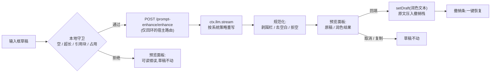

# dsh-prompt-polish

[](https://github.com/rangercd67/dsh-prompt-polish/actions/workflows/ci.yml)
[](./LICENSE)

**DeepSeek Harness Web GUI 的「提示词润色」插件** —— 一次点击(或一个快捷键)就能把输入框里的草稿改写成可直接使用的提示词,而你的原文始终保留。

> ### 衍生项目,请先读这一段
>
> `dsh-prompt-polish` 是 [`dsh-prompt-enhance`](https://github.com/rongxingda/dsh-prompt-enhance)(作者 rongxingda,Apache-2.0)的**修改版非官方衍生项目**。本项目 `1.0.0` 基于上游 **0.2.7**。
>
> **本分支做了什么:** 让插件在 dsh `0.2.x` 运行时上**真正可配置**(上游那套配置装配已从宿主移除,它的设置项实际上无法读写);自带独立配置页;修掉了条目重挂载时泄漏 HTTP 路由的缺陷;放弃 0.2 之前的宿主;内置改写策略换成精简版。完整清单见 [与上游的差异](#与上游的差异)与 [CHANGELOG.md](./CHANGELOG.md)。
>
> **非官方背书。** 这不是上游项目的官方发布,与上游作者及 DeepSeek 均无隶属或背书关系。署名与被修改文件清单见 [NOTICE](./NOTICE)。
>
> **安装前请知悉两件事。** (1) 插件提供一条**不带鉴权**的回环 HTTP 路由:本机任意进程都能调用它并消耗你的模型额度。(2) 你润色的草稿——以及在 `contextAware` 开启时最多 `contextMaxMessages` 条近期对话——会发送给你配置的模型服务商。两点的细节见[安全与隐私](#安全与隐私)。

[English](./README.md) | 简体中文

---

## 这是什么

一个给 [DeepSeek Harness](https://github.com/deepseek-ai) Web GUI 用的插件。它给输入框加了一个**润色**入口:草稿经低温重写(走 harness 自带的 LLM 服务),结果与原稿并排显示在预览面板里,你可以选择回填、复制或丢弃;回填后输入框上方出现撤销条,一键恢复你原本输入的内容。

单包双半区,遵循 dsh 插件规范:**宿主半区**(Node)持有 HTTP 路由、`/enhance` 斜杠命令与设置命名空间;**浏览器半区**提供输入框按钮、预览面板、撤销条与配置页。

## 为什么会有这个分支

harness 的 `0.2.x` 改动了本插件依赖的三处东西,结果是插件能装上去、却什么都不受你控制:

1. **配置能力静默消失。** dsh `0.2.x` 从包导出的 `Config` schema 推导插件的设置命名空间,且只保留 meta 标记为 `volatile` 的字段。上游一个都没标记,于是条目被整体跳过——没有配置页、没有表单、没有任何写入途径;而它用来替代该机制的那套 `installSection` / `installSettingsSection` 装配其实早已从宿主移除,兼容探测跑完就返回,既没生效也不报错。本分支把每个字段标记为 volatile,并按 `0.2.x` 期望的方式提供命名空间。
2. **插件一旦重挂载就起不来。** 上游丢弃了 `webserver.register()` 返回的 disposer,`/prompt-enhance` 前缀路由因此比拥有它的条目活得更久;下一次挂载直接死在 `webserver: duplicate prefix route "/prompt-enhance"`,条目停在 `failed`,不重启宿主无法恢复。本分支把 disposer 挂在 effect 上。
3. **用户找不到任何可编辑的地方。** 因为上游依赖的设置分区已不存在,想改一个参数只能手改 profile 的补丁文件。本分支自己注册 `plugins.row.config` 页,于是**插件页**那一行的配置入口会打开一个真正的表单。

此外,内置策略换成了精简版(不再强制验收标准、边界条件小节,也不再插入 `(待补充:…)` 占位符),`maxOutputTokens` 默认值由 2048 提到 6000——中文长草稿「重写结果达到输出上限」正是它导致的。

## 功能一览

| | |
|---|---|
| ✨ **输入框按钮** | 工具栏内发送键旁的小按钮,随手可及 |
| 🔀 **对比预览面板** | 原稿与润色结果左右并排,附模型名与耗时 |
| ↩️ **一键撤销** | 回填后输入框上方出现撤销条,一键恢复原文 |
| ⌨️ **快捷键** | 默认 `Ctrl+Alt+E`,可配置,作用于你正在使用的输入框 |
| 💬 **`/enhance` 命令** | 斜杠面板直接改写任意文本;结果不进入模型历史 |
| 🧠 **模型路由** | 设置成对覆盖 → 当前会话模型 → 全局默认模型,依次回退 |
| 🔑 **零凭据配置** | 调用走 harness LLM 服务,密钥留在 harness 凭据存储里 |
| ⚙️ **配置即改即用** | 十六个字段全部在随包提供的配置页上编辑,下一次调用即生效 |
| 🛡️ **草稿安全** | 空输入、超长、仅图片、含引用块在本地拦截;上游失败映射为可读提示;失败的调用绝不改动草稿 |


## 装进 dsh profile

本项目已为独立发布做好准备,但**尚未发布到 npm**,目前 registry 上并没有这个名字。在此之前,请用 dsh 插件 CLI 从检出目录(或本仓库的 GitHub 地址)安装:

```bash
# 从本地检出安装(构建产物已随仓库提交,无需本地构建)
git clone https://github.com/rangercd67/dsh-prompt-polish.git
dsh plugin --profile web add link:/path/to/dsh-prompt-polish
# 重启 dsh web
```

```bash
# 从 GitHub 地址安装
dsh plugin --profile web add github:rangercd67/dsh-prompt-polish
```

等 `dsh-prompt-polish` 以这个名字发布之后,直接用包名安装就是最短路径:

```bash
dsh plugin --profile web add dsh-prompt-polish
# 重启 dsh web
```

本包插入的行 **id 是 `prompt-enhance`**,行 `name` 是 `dsh-prompt-polish`。id 是刻意保持不变的:它是设置命名空间键,且所有既有 profile 补丁都指向它;只有 [`cordis.patch.yml`](./cordis.patch.yml) 里的 `name:` 跟随包名。

卸载:

```bash
dsh plugin --profile web remove dsh-prompt-polish
# 检查 profile 的 package.json 中 `dsh.profile.bundles` 数组有无残留行,
# 有则手动删除,然后重启 dsh web
```

如果你在用 dsh **桌面应用**、并习惯通过 profile 管理器而非 CLI 安装,验证本构建时使用的确切 `install_bundle` 与回滚步骤记录在 [1.0.0 发行说明](./docs/history/release-1.0.0.md)中。

## 配置

十六个字段全部位于 `prompt-enhance` 设置命名空间。在**插件页**找到本插件的行,用它的配置入口打开表单(行键是 `dsh-prompt-polish#prompt-enhance`,由本包自行注册,不需要任何配套插件)。若你的 profile 同时打包了 harness 自带的设置面板,同一命名空间也会出现在 **设置 → 插件配置**。改动作用于下一次调用,无需重启。

每次润色都是一次计费的 LLM 调用:`maxOutputTokens` 约束单次成本,`maxConcurrent` / `rateLimitPerMinute` 约束调用频率。

| 字段 | 默认 | 说明 |
|---|---|---|
| `enabled` | `true` | 总开关;关闭隐藏输入框按钮并停用全部触发方式 |
| `provider` | *(空)* | 显式路由覆盖;必须与 `model` **成对**填写(或两者都留空以跟随当前会话模型) |
| `model` | *(空)* | 显式路由覆盖;必须与 `provider` **成对**填写 |
| `temperature` | `0.3` | 采样温度(0–1);低温使改写更忠实原意 |
| `strategyMode` | `replace-default` | 自定义 `systemPrompt` 的组合方式:`replace-default` **整体替换**内置策略(内置的「不改变原意、不编造、只输出正文、镜像输入语言」等硬性约束不会自动保留,需自行写入);`extend-default` 把自定义文本**追加在内置策略之后**,硬性约束继续生效 |
| `systemPrompt` | *(空 → 内置策略)* | 自定义策略文本;留空使用内置的精简策略 |
| `shortcut` | `ctrl+alt+e` | 快捷键规格(须包含 ctrl/alt/meta 中至少一个修饰键,再加一个字母/数字/功能键;纯裸键会被忽略,绝不会吞掉正常打字);留空禁用 |
| `maxOutputTokens` | `6000` | 单次润色的输出 token 预算(256–32768),约束该次调用的成本 |
| `maxInputChars` | `12000` | 输入字符数上限(200–200000),按 Unicode 码点统计——一个 emoji 算一个字符;超限**拒绝而不截断** |
| `timeoutMs` | `60000` | 单次调用的端到端超时(5000–600000 毫秒) |
| `maxConcurrent` | `2` | **单个 Host 进程内**的并发上限(1–16);超出的请求返回 `429`(`concurrency-limit`)。浏览器 UI 因只有一个预览面板,天然只允许 1 个在途请求,此上限主要保护 `/enhance` 命令入口与多客户端调用 |
| `rateLimitPerMinute` | `10` | **单个 Host 进程内**的每分钟滑动窗口限流(1–600),只统计**成功完成**的调用——失败不消耗窗口,连续失败不会把自己限流;超出的请求返回 `429`(`rate-limit`),响应附 `Retry-After` 秒数 |
| `streaming` | `true` | 模型边写边在面板展示,而非等整段写完——**仅影响显示节奏**:最终应用的仍是归一化的完整结果;宿主或网络不支持 `text/event-stream` 时客户端自动回退为一次性 JSON 请求 |
| `contextAware` | `true` | 用当前会话的近期历史为改写提供依据(消解指代、补全已声明的约束、沿用已确立的技术栈与术语)。无会话、无历史、或关闭此开关时,自动回退为单条润色。**隐私:** 装配好的片段会随草稿一起发给配置的服务商,详见[安全与隐私](#安全与隐私) |
| `contextMaxMessages` | `8` | 上下文广度:最多参考多少条最近 `user`/`assistant` 轮次(0–50);`0` 表示不参考 |
| `contextMaxChars` | `4000` | 上下文深度:历史片段的字符预算(0–100000),从最新一条向前装配,预算紧张时最近的轮次优先;`0` 表示不参考 |

**`provider` / `model` 取值**与 harness 设置一致:harness 的 provider 设置里的每个键(如 `zhipu`、`muyuu`)就是一个 provider,其下 `models[].id`(如 `glm-5.3-flash`)就是一个 model。示例:`provider: zhipu` + `model: glm-5.3-flash`。

**模型路由优先级:** 设置成对覆盖 → 当前会话请求头中记录的路由 → 全局默认模型。三者都指不出路由时(例如全新会话且无默认模型),插件给出可操作的报错而不是乱猜。

## 工作原理



**宿主半区**(`exports "."`,Node)—— 在共享 webserver 上注册 `/prompt-enhance` 前缀路由(`POST /prompt-enhance/enhance` 返回单个 JSON 信封,`POST /prompt-enhance/enhance-stream` 返回增量 SSE 帧)、`/enhance` 斜杠命令,以及由本包导出的 `Config` schema 推导出的 `prompt-enhance` 设置命名空间。模型调用走 `ctx.llm.stream`,并做规范化处理,遵循 harness 对会话标题相同的辅助调用纪律:流过程中与结束后复查超时和调用方取消、校验终结 finish、拒绝工具调用。配置按请求从活的组合配置读取,因此保存后的改动无需重挂载即可在下次调用生效。

**浏览器半区**(`exports "./client"`)—— 把润色按钮注册进 `conversation.input.right` 插槽、撤销条注册进 `conversation.input.dock` 插槽,维护设置命名空间的实时镜像,安装全局快捷键,并注册键为 `dsh-prompt-polish#prompt-enhance` 的 `plugins.row.config` 配置页。全部文案经 harness locale 系统提供中英双语。这一半不硬依赖任何服务:`slots`、`locale`、`configForms` 都走可选的 `ctx.inject`,缺少某个服务时只降级(用内置默认值、渲染字典键),不会卡住整个 web 启动。

**配置页** —— 表单就是 harness 共享的 `SettingsForm` / `SettingsFormModel` 机制作用于 `prompt-enhance` 命名空间,因此天然具备覆盖标记、逐字段恢复默认、按 revision 加锁的保存,以及只读/不可用状态。页面本身就在本 bundle 里,编辑这个插件不需要再装别的东西。

### 怎么用

**输入框按钮 / 快捷键** —— 输入(或留着)草稿,点 ✨ 或按 `Ctrl+Alt+E`:

1. 先跑本地守卫:空草稿、超长草稿(**不自动截断**——截断会改变原意)、仅图片草稿、含命令或文件引用块的草稿,都会给出明确提示并拒绝。引用块被拒是因为回填会破坏它们。
2. 预览面板打开,显示可取消的加载动画。此时草稿原封不动,面板上也写明了这一点。
3. 结果阶段左右并排展示两份文本。**回填**把润色文本写回输入框并升起撤销条;**复制**进剪贴板;**取消**(`Esc` 或点击遮罩)丢弃一切。
4. 撤销条停在输入框上方:一键恢复原文。回填后你继续输入,撤销条会安静地自我退位——过期的原文永远不会覆盖你更新的编辑。撤销记录**只存在于当前页面内存**(每个会话最多 3 条),刷新页面、重启 Web 或切换会话后即失效。

**`/enhance <文本>`** —— 从斜杠菜单改写任意文本。结果在命令面板渲染(可复制),不进入会话历史与模型上下文。要润色**输入框里的草稿**请用按钮或快捷键——草稿在浏览器里。正在运行的 `/enhance` 取消跟随 harness 命令面板能力;客户端未提供取消入口时,调用会执行到完成或超时。

**语言一致性** —— 策略要求模型保持输入语言(中文进中文出)。这是尽力而为的约束,不是硬保证。

### 内置策略

默认系统提示词让模型扮演提示词编辑者:写清目标与交付物,补上任务真正需要的步骤,把草稿本身暗示的约束放在一个简短的引导句下。结构只做到任务需要的程度——不再强制验收标准、边界条件、角色或输出格式小节,也**不再插入 `(待补充:…)` 占位符**:未知细节直接略去,只有缺失到任务根本无法执行时,才在末尾留一句确认问题。长度目标约为原文 1–2 倍,已经清楚的提示词只做轻度润色而不注水。

硬性规则:精确保留原意;绝不编造事实、数据、名称、数字或约束;保持任务范围不变;**只输出**改写后的正文(无解释、无围栏、无客套);镜像输入语言;把框定的草稿视为纯数据。

填写 `systemPrompt` 即可自定义策略,组合方式由 `strategyMode` 决定:默认 `replace-default` 是**完全替换**——内置硬性规则不会自动保留,你的文本需要自己包含它们;`extend-default` 则把自定义文本追加在内置策略之后,硬性约束继续生效。

### 异常与边界

| 情形 | 行为 |
|---|---|
| 空 / 纯空白 / 零宽字符草稿 | 本地拒绝:「输入框为空」 |
| 草稿超过 `maxInputChars` | 本地与路由双重拒绝并给出精确字符数;**不自动截断** |
| 只附加了图片没有文本 | 拒绝:仅支持文本 |
| 草稿含命令 / 文件引用块 | 拒绝:回填会破坏引用块 |
| 提交中 / 占用阶段 / 已有请求在途 | 拒绝并提示「稍后再试」 |
| 每分钟次数超限 | `429`(`rate-limit`),响应附 `Retry-After` 秒数,宿主消息给出精确等待时长;窗口只统计成功完成的调用 |
| 并发已满 | `429`(`concurrency-limit`),无 `Retry-After`——在途调用一结束就会空出槽位 |
| 上游模型失败 | 稳定错误码映射为可读提示:`AUTH` → 检查 API Key、`RATE_LIMIT` → 稍后重试、`QUOTA_EXCEEDED` → 检查余额、`CONTEXT_WINDOW_EXCEEDED` → 精简输入、`NO_ADAPTER`/未配置 → 先配置模型 |
| 输出达到 `maxOutputTokens` | 拒绝并提示调大上限或精简原文 |
| 模型返回空 / 围栏包裹 / 工具调用 | 规范化(剥围栏)或拒绝;可重试 |
| 超时 | 映射为 `504` 的提示并给出配置秒数;可重试 |
| 浏览器中途关闭 | 宿主路由侦测连接断开,立即中止模型调用 |
| 切换会话 | 面板状态、撤销栈、快捷键目标均按会话隔离;切换即关闭面板并清理撤销记录 |

所有失败只出现在插件自己的面板里;失败的调用绝不修改输入框草稿,手动输入不受任何干扰。

宿主路由返回的结构化错误形如 `{ code, message?, params? }`:主文案由浏览器按 `code` + `params` 从当前语言字典渲染,`message` 只是可选的诊断细节(服务商原始报错、配置错误原文),原样展示在主文案下方。`/enhance` 命令平面没有 locale 字典,由宿主侧的同源渲染函数直接产出中文文本。

| 错误码 | HTTP 状态 | 浏览器主文案(字典键) | 参数 |
|---|---|---|---|
| `rejected` | 403 / 413 / 415 / 422 | `error.rejected` 通用;携带 `{ count, max }` 时复用 `error.tooLong` | 超长输入: `{ count, max }` |
| `rate-limit` | 429 | `error.rateLimit` | `{ limit, retryAfterSeconds }` |
| `concurrency-limit` | 429 | `error.concurrencyLimit` | `{ max }` |
| `timeout` | 504 | `error.timeout` | `{ seconds }` |
| `unconfigured` | 409 | `error.unconfigured` | — |
| `upstream` | 502 | `error.upstream` 通用;携带 `reason` 时用 `error.upstream.{reason}`(`auth` / `invalidCredential` / `rateLimit` / `quota` / `empty` / `contextWindow` / `toolCall` / `maxTokens`) | `{ reason }` |
| `internal` | 500 / 502 | `error.internal` | — |

### 故障排查

**按钮不出现 / 快捷键无响应** —— 打开插件的配置页(插件页那一行的配置入口)确认 `enabled`;确认插件已安装(`dsh plugin --profile web list`)且重启过 `dsh web`;查看浏览器控制台有无应用报错。

**「尚未确定润色用的模型」** —— 路由遵循设置成对覆盖 → 会话模型 → 全局默认模型;三者都为空时无处可调。在设置中成对填写 `provider`/`model`,或先在当前会话发一条消息让会话带上模型路由,并检查 harness 的默认模型设置分区。

**鉴权失败** —— `message` 细节行会带出具体原因(如 401)。检查对应 provider 在 harness 凭据存储中的 API Key;配额/余额问题对应 `quota` 提示。

**连续失败后立刻被限流(429)** —— 不应发生,因为限流窗口只统计成功调用。若仍遇到,确认是否同时挂载了多个 profile / 多进程(各自独立计数会叠加),或 `rateLimitPerMinute` 配置过低。

**结果不理想(编造、丢要求、格式乱)** —— `strategyMode` 为 `replace-default` 时,自定义 `systemPrompt` 会连同内置硬性规则一起被整体替换;请自行写入这些约束,或改用 `extend-default`。

**改名后设置像是丢了** —— 命名空间与行 id 仍是 `prompt-enhance`,所以已保存的取值与既有 profile 补丁在 `dsh-prompt-enhance` → `dsh-prompt-polish` 改名后继续有效。改变的是包名,以及随之而来的配置页行键(`<包名>#prompt-enhance`);该键在构建时注入,因此手工构建的旧包名产物在重新构建前不会显示配置页。

## 安全与隐私

**1. 回环 HTTP 路由按设计不带鉴权。** 本机任意进程都可以 `POST /prompt-enhance/enhance` 并消耗你的模型额度,插件不做按调用方的鉴权。取而代之的护栏是:

- **套接字栅栏** —— 非回环对端地址(`127.0.0.1` / `::1` 之外)的请求一律拒绝。
- **Host 白名单** —— `Host` 头必须是 `localhost` / `127.0.0.1` / `[::1]`,可防御 DNS 重绑定(重绑定的攻击者域名虽落在回环套接字上,但携带的是攻击者主机名,会被拒绝)。响应均为 `cache-control: no-store`。
- **Origin 门** —— 来自非本地页面的浏览器调用被拒绝。
- **代理请求拒绝** —— 携带 `X-Forwarded-For` 或 `Forwarded` 的请求直接拒绝:这些头只在链路上存在代理时出现,而代理场景不在本路由的信任模型内。
- **滥用上限** —— 由 `maxInputChars` 推导的 body 上限(含 `Content-Length` 快速拒绝)、滑动窗口限流(`rateLimitPerMinute`,默认 10,只统计成功调用)与并发上限(`maxConcurrent`,默认 2),超限均返回 `429`。两项计数保存在**单个宿主进程的内存中**:多进程、cluster 或多个 profile 同时挂载时各自独立计数,因此本插件只支持单进程部署,也不提供共享限流存储。
- **请求级超时属于宿主与 Node** —— 插件只限制 body 大小与单次调用的 `timeoutMs`;连接级超时(headers / request / keep-alive)是共享 `http.Server` 的配置,前缀路由不应触碰,由宿主与 Node 默认值兜底。
- **不要经反向代理暴露** —— 若把 dsh web 放在监听局域网的代理后面,外部调用者在路由看来就是回环地址,栅栏形同虚设。除非在代理层自行加鉴权,否则不要暴露。
- **提示注入边界** —— 草稿被框在 `<raw_prompt>` 标签之间,草稿内的字面闭合标签会被中和,策略提示词把框内文本视为纯数据。这降低简单标签逃逸的风险;基于提示词的边界是尽力而为,并非保证。

**2. 你的草稿会离开本机——发往你自己配置的服务商。** 浏览器 → 你自己的 dsh 宿主(仅回环)→ harness LLM 服务 → 配置的模型服务商。`contextAware` 默认开启时,插件还会装配当前会话近期的 `user`/`assistant` 历史(最多 `contextMaxMessages` 条、`contextMaxChars` 个字符),与草稿一起发给同一服务商。该历史可能包含你之前在会话里输入过的密钥、token、内网主机名、客户名称等,服务商会**原文看到**。请把 `contextAware` 视为隐私边界:不该外发的会话,关闭该开关,或结束会话重开一个再润色。策略里的规则只能禁止模型引入原文不支持的信息,**无法撤回已经发出去的内容**。

**凭据留在 harness。** 插件不存储任何凭据;模型调用走 `ctx.llm`,API Key 由 harness 持有。润色过程绝不进入会话的模型历史,除 harness 为这次调用选定的服务商之外不发送到任何地方。

## 兼容性

- **宿主:** `dsh.engines.dsh` = `>=0.2.0-rc.2 <0.3.0`。本分支放弃 0.2 之前的宿主:它所替代的那套设置装配在那些版本里已不存在。`dsh.engines` 是加载器与插件管理器读取的声明性元数据——表达支持范围,并不强制拦截。
- **Node:** `^22.19.0 || >=24.0.0`(仅从源码构建时需要)。
- **Peer:** `@deepseek-ai/dsh-llm >=0.2.0-rc.2` 为**可选** peer——它是由 dsh 宿主提供的运行时模块,不从 npm 安装(两份 `lib/` 产物把包引用全部保持为外部),因此未提供它的环境不会出现安装警告,润色时按正常错误路径报错,而不是加载失败。`react` / `react-dom` `^18.2.0` 为必需 peer,由 Web 壳的模块注册表提供。
- **`0.2.x` 上的其他插件:** 运行时的兼容性闸门会跳过 peer 范围锁在旧 `@deepseek-ai/dsh-*` 版本线上的 bundle(上游实测被跳过的是 `dshmarket`、`dsh-find-plugin`、`dsh-better-sidebar`)。本包能通过该闸门。

| | |
|---|---|
| dsh | `>= 0.2.0-rc.2 < 0.3.0` |
| Node | `^22.19.0 \|\| >=24.0.0` |
| 插件 | `1.x` |

## 开发

```bash
npm install
npm run typecheck     # tsc,不产出
npm test              # 单元 + 真实 HTTP + 组件测试套件
npm run build         # 类型检查 + 双半区构建
npm run watch         # esbuild 监听构建双半区
npm run rename -- --check   # 包名与补丁行名是否一致?
```

日常调试闭环(link 安装 + watch)见 [CONTRIBUTING.md](./CONTRIBUTING.md)。

**`lib/` 是构建产物,且随仓库提交。** `lib/index.js` 是宿主半区(ESM,包引用保持外部);`lib/client.js` 是浏览器半区(打包为 CJS,包进 dsh web 壳要求的 `window.__ModuleLoader__.load({ id, factory })` 信封)。两者都提交,因此 GitHub 直装无需构建;CI 会在 `lib/` 与 `src/` 不一致时拒绝合并——推送前务必跑 `npm run build`。**客户端 bundle 携带构建时注入的包名**(`scripts/build.mjs` 的 `define`,`vitest.config.ts` 同步),因为插件页按 `<包名>#<行 id>` 派发行配置入口:改名而不重新构建,配置页会静默消失。`npm run rename -- --name <包名> [--repo <仓库地址>]` 一步完成改名,`--check` 报告 `package.json` 与 `cordis.patch.yml` 是否一致。行 **id** 永远是 `prompt-enhance`,不得更改。

**测试覆盖**(21 个文件 / 216 条用例):输入校验、输出规范化、以桩 `ctx.llm` 流驱动的增强器、真实 `node:http` 路由套件(回环/Host 栅栏、断开中止、错误信封、SSE 端到端)、回环栅栏单测、提示词框架化、配置解析、撤销栈、快捷键解析、客户端设置、配置页,以及锁定「润色 → 回填 → 撤销」全流程的 React 组件测试。

更多:[架构说明](./docs/dev/architecture.md) · [使用与配置详解](./docs/guide/usage-and-configuration.md) · [`0.2.x` 兼容性调查](./docs/compat/dsh-0.2-findings.md) · [文档索引](./docs/README.md)。

## 发布

发布清单——包名与元数据、`ROW_KEY` 这条承重耦合、许可证与署名义务、tarball 检查,以及发布后的验证步骤——在 [docs/publish/checklist.md](./docs/publish/checklist.md)。本仓库没有任何自动发布机制,CI 也不含发布步骤。

## 许可证与署名

[Apache-2.0](./LICENSE)。`dsh-prompt-polish` 是 [`dsh-prompt-enhance`](https://github.com/rongxingda/dsh-prompt-enhance)(Apache-2.0)的衍生项目,基于上游 0.2.7;上游许可证原文保持不变,署名、被修改文件清单与「非官方背书」表述见 [NOTICE](./NOTICE)。本分支自己的版本线从 `1.0.0` 起,与上游编号互相独立——见 [CHANGELOG.md](./CHANGELOG.md)。

## 与上游的差异

对照上游 `dsh-prompt-enhance` 0.2.7(本项目 1.0.0 的基线)。完整理由见 [1.0.0 发行说明](./docs/history/release-1.0.0.md)与[兼容性调查](./docs/compat/dsh-0.2-findings.md)。

| 方面 | 上游 0.2.7 | 本项目 1.0.0 |
|---|---|---|
| `0.2.x` 上的设置命名空间 | 没有任何 `Config` 字段标记 volatile,宿主整体跳过该条目,任何界面都不可配置 | 每个 `Config` 字段都标记 volatile(通过公共 schemastery 的 `meta`),`0.2.x` 因此提供 `prompt-enhance` 命名空间 |
| 配置页 | 无;依赖已被宿主移除的 `installSection` / `installSettingsSection` | 自带键为 `dsh-prompt-polish#prompt-enhance` 的 `plugins.row.config` 页,用 harness 的 `SettingsForm` / `SettingsFormModel` 原语渲染;不需要配套包 |
| 路由生命周期 | 丢弃 `webserver.register()` 返回的 disposer,`/prompt-enhance` 活得比条目久,下一次挂载因 `duplicate prefix route` 失败,直到重启宿主 | 把 disposer 挂在 effect 上,并清理按上下文的挂载守卫,因此开关 bundle 能重新激活 |
| 内置策略 | 六个强制小节(含验收标准、边界条件)与 `(待补充:…)` 占位符;长度目标 1–3 倍 | 结构只做到任务需要的程度,无占位符,只有缺失到无法执行时才留一句确认问题;长度目标 1–2 倍 |
| `maxOutputTokens` 默认 | `2048` | `6000` |
| 客户端设置镜像 | 读取已被移除的 `settingsScope`,永久停在内置默认值——`enabled: false` 从不隐藏按钮 | 读取 `configForms`,保存后镜像立即跟随 |
| 宿主适配 | 接入随后被改动的运行时 API(设置注册、请求头路由读取、cordis 服务查找) | 仅面向 0.2:`dsh.engines.dsh` 为 `>=0.2.0-rc.2 <0.3.0`,调用声明自己的 `MessageSourceMap` kind,devDeps 锁在 0.2.0-rc.2 客户端线 |
| 版本线 | `0.2.x` | `1.0.0`,自成一线的编号,不是上游编号的延续 |

从上游原样保留的部分:输入框按钮 / 预览面板 / 撤销条流程、`/enhance` 命令、回环 + `Host` + `Origin` 三重栅栏与滥用上限、`<raw_prompt>` 框架化、有界的会话上下文片段,以及[安全与隐私](#安全与隐私)中的两项披露。

## 致谢

回环栅栏、插件骨架与设置分区的写法遵循 dsh 插件家族的既有惯例——特别是 [`@linxin666/dsh-tool-describe-image`](https://www.npmjs.com/package/@linxin666/dsh-tool-describe-image)。感谢 [`dsh-prompt-enhance`](https://github.com/rongxingda/dsh-prompt-enhance)上游作者的工作——本项目正是在其基础上修改而来。
